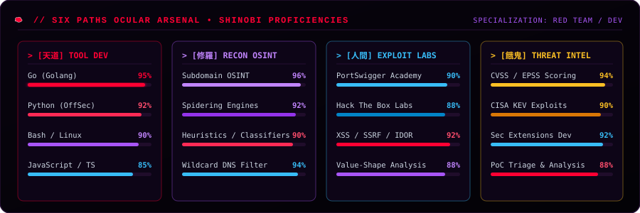
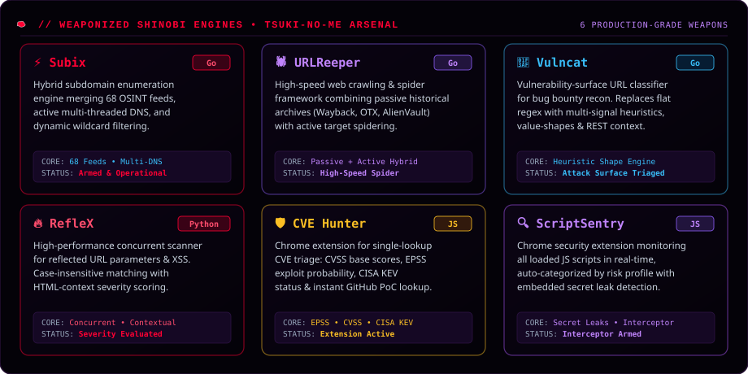
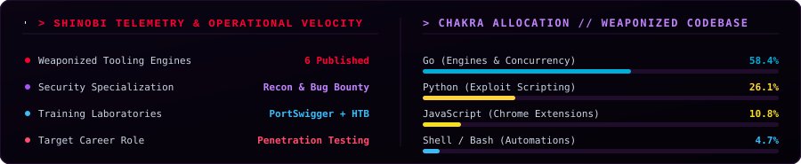
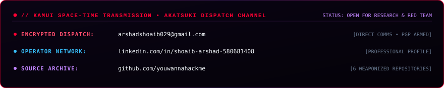
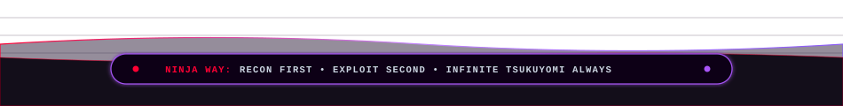

<!-- ================= HERO ANIMATED OBITO BANNER ================= -->

 

<!-- ================= DYNAMIC SHINOBI TYPING TERMINAL ================= -->

 

<!-- ================= AKATSUKI SOCIAL BADGES ================= -->

  
  
  
  
  

<!-- ================= CHAKRA PROFILE VIEW COUNTER ================= -->

  

 

<!-- ================= KAMUI VOID RIFT DIVIDER ================= -->

  

 

<!-- ================= OPERATOR IDENTITY & SHINOBI LORE ================= -->
## 👁️ Shinobi Identity &amp; Kamui Protocol

<table>
  <tr>
    <td width="38%" align="center" valign="middle">
      
       
      <i>「 神威 • 虚化 — Reality is but an illusion. 」</i>
    </td>
    <td width="62%" valign="middle">
      <h3>🔥 Operator: <code>whoami_404</code> // Shoaib Arshad</h3>
      

        Cybersecurity researcher, bug bounty hunter, and offensive toolsmith engineering high-speed security software from first principles — specializing in <b>high-velocity subdomain discovery</b>, <b>active/passive spidering frameworks</b>, <b>heuristic attack-surface classifiers</b>, and <b>real-time CVE triage engines</b>.
      

      

        Just as <b>Kamui (神威)</b> allows phasing through any physical defense into space-time dimensions, modern offensive security requires transcending flat regex checks and piercing through edge firewalls, WAFs, and perimeter illusions directly to the underlying vulnerability surface.
      

      

        Currently advancing through <b>PortSwigger Web Security Academy</b> and <b>Hack The Box</b> while testing live targets and preparing for Red Team / Penetration Testing opportunities.
      

      

        <blockquote>
          <i>"In the ninja world, those who break the rules are scum, that's true, but those who abandon recon are worse than scum. There is no perimeter when you phase through reality."</i>
           
          <b>— Obito Uchiha (うちは オビト)</b>
        </blockquote>
      

    </td>
  </tr>
</table>

 

<!-- ================= ANIMATED INTERACTIVE TERMINAL ================= -->

  

  

<!-- ================= KAMUI VOID RIFT DIVIDER ================= -->

  

 

<!-- ================= SIX PATHS ARSENAL & WEAPONIZED STACK ================= -->
## ⚡ Six Paths Ocular Arsenal &amp; Weaponized Stack

<!-- ANIMATED SKILLS MATRIX -->

  

<!-- TECH ICON DOCK -->

  

<!-- OFFSEC SPECIALIZATION BADGES -->

  
  
  
  
  

  

<!-- ================= KAMUI VOID RIFT DIVIDER ================= -->

  

 

<!-- ================= WEAPONIZED SHINOBI ENGINES ================= -->
## 🛠️ Weaponized Shinobi Engines &amp; Featured Projects

<!-- ANIMATED PROJECTS SHOWCASE -->

 

| Shinobi Engine | Core Tech | Architecture &amp; Attack-Surface Capabilities | Status |
|---|:---:|---|:---:|
| ⚡ **[Subix](https://github.com/youwannahackme/subix)** | `Go` | Hybrid subdomain enumeration engine combining **68 passive OSINT sources** with active multi-threaded DNS resolution, dynamic wildcard filtering, and recursive scanning. |  |
| 🕷️ **[URLReeper](https://github.com/youwannahackme/urlreeper)** | `Go` | High-speed web crawling &amp; spidering framework for security recon — merges passive discovery (Wayback, OTX, AlienVault) with concurrent active target crawling. |  |
| 🎯 **[Vulncat](https://github.com/youwannahackme/vulncat)** | `Go` | Vulnerability-surface URL classifier for bug bounty hunting. Replaces flat regex matching with multi-signal heuristics, parameter value-shape analysis, and REST API context awareness. |  |
| 🔥 **[RefleX](https://github.com/youwannahackme/RefleX)** | `Python` | High-performance concurrent scanner for reflected URL parameters and potential XSS, featuring case-insensitive matching and HTML-context severity scoring. |  |
| 🛡️ **[CVE Hunter Pro](https://github.com/youwannahackme/CVE-Hunter-Extention)** | `JavaScript` | Chrome extension for single-lookup CVE triage — CVSS base scoring, EPSS exploit probability, CISA KEV exploitation status, and GitHub PoC discovery in one popup. |  |
| 🔍 **[ScriptSentry](https://github.com/youwannahackme/ScriptSentry-Extention)** | `JavaScript` | Chrome extension that monitors and intercepts every JS URL a page loads in real time, auto-categorized by risk with embedded secret leak detection. |  |

  

<!-- ================= KAMUI VOID RIFT DIVIDER ================= -->

  

 

<!-- ================= REAL-TIME TELEMETRY & CHAKRA VELOCITY ================= -->
## 📊 Chakra Velocity &amp; Shinobi Telemetry

<!-- LOCAL SELF-CONTAINED METRICS CARD -->

  

<!-- STREAK STATS WIDGET IN OBITO CRIMSON & VOID THEME -->

  

<!-- ================= KAMUI VOID RIFT DIVIDER ================= -->

  

 

<!-- ================= SNAKE CONTRIBUTION RADAR ================= -->
## 🐍 Space-Time Contribution Grid Radar

<!-- SNAKE ANIMATION -->

  ⚡ Automatically compiled by <b>GitHub Actions</b> on a 6-hour cron schedule.

  

<!-- ================= KAMUI VOID RIFT DIVIDER ================= -->

  

 

<!-- ================= CONNECT & ENCRYPTED DISPATCH ================= -->
## 🤝 Kamui Space-Time Transmission &amp; Collaboration

<!-- ANIMATED CYBER DISPATCH CARD -->

  

<!-- DIRECT INTERACTIVE CONTACT BUTTONS -->

  
  &nbsp;&nbsp;
  
  &nbsp;&nbsp;
  

 

<!-- ================= KAMUI VOID RIFT DIVIDER ================= -->

  

 

<!-- ================= INFINITE TSUKUYOMI FOOTER ================= -->

